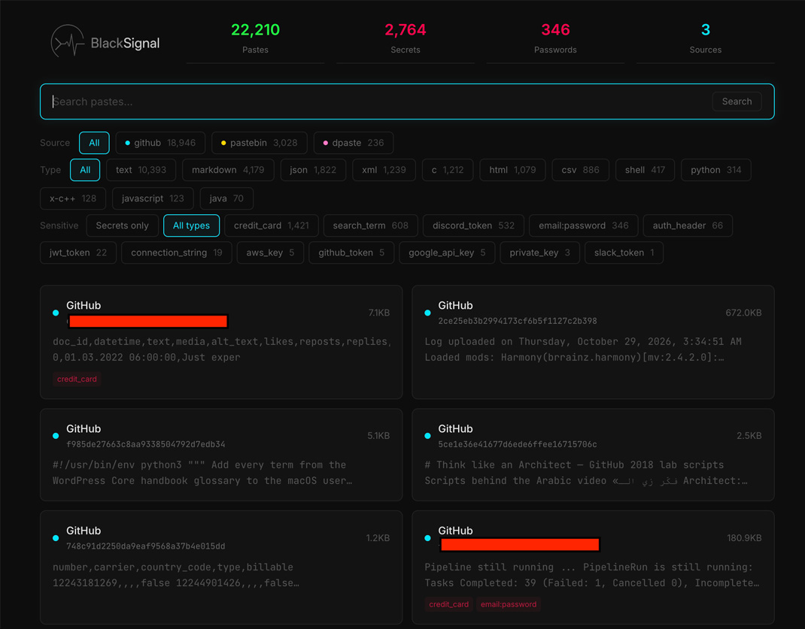
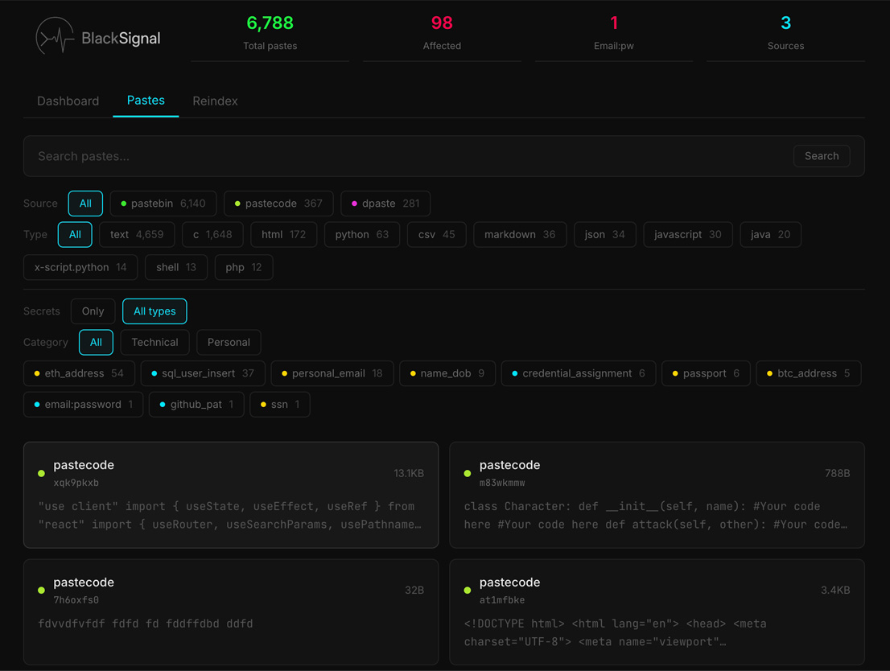

# BlackSignal


A fast, self-hosted web application to **browse, search, categorize and analyze paste data** from multiple paste sites (e.g. Pastebin, GitHub Gists, dpaste, pastes.io). It indexes pastes into a full-text search engine and automatically flags **sensitive information** — leaked credentials, API keys, private keys, connection strings and more.

Best used in combination with my paste scraper project [rndinfosecguy/Scavenger](https://github.com/rndinfosecguy/Scavenger).

> **FOR RESEARCH ONLY.** This tool is intended for researchers and defenders to detect exposed secrets on public paste sites before attackers exploit them. Do not host or distribute breach data.

---

## Features

### Dashboard


### Analyze Pastes


- **Search & browse** — full-text search (SQLite FTS5) 
- **Filtering** — by source site, detected content type, sensitive-data categories and technical/personal classification
- **Sensitive-data detection** — automatic regex/keyword scanning for:
  `email:password`, `credential_assignment`, `private_key`, `aws_key`, `github_token`, `github_pat`, `stripe_key`, `google_api_key`, `jwt_token`, `slack_token`, `discord_token`, `connection_string`, `onion_address`, `auth_header`, `credit_card`, `sql_user_insert`, `mysql_connect`, `wp_config`, `client_secret` + custom search terms via `backend/searchterms.txt`
- **Personal data detection** — identifies exposed personally identifiable information: `personal_email`, `ssn` (US Social Security Numbers), `passport` (passport numbers), `btc_address` (Bitcoin wallet addresses), `eth_address` (Ethereum wallet addresses), `name_dob` (name + date of birth on the same line)
- **Detailed paste view** — detected secrets are shown at the top. Whole paste with inline highlighting can be expanded.
- **Syntax highlighting** — highlight.js for different coding languages
- **Dashboard** — overview tab showing technical and personal detection rates, source/type distributions, and per-type breakdowns
- **Comprehensive reindex** — optional full-content scan mode (bypasses size limits) for deep inspection of large files
- **Periodic re-indexing** — automatic daily scan for new/changed pastes (interval configurable in the Config tab)
- **Export findings** - download search results as CSV or JSON with the current filter state
- **LLM analysis per paste (optional)** —  produces a structured markdown summary with technical and personal findings plus a risk assessment. Requires an OpenRouter API key (see [LLM Integration](#llm-integration-optional)).
- **LLM batch report (optional)** — analyzes every paste matching the current filters individually, then creates an overall security report..
- **HTTP Basic Auth** — htpasswd protection, credentials auto-generated on first boot

## Tech Stack

| Layer | Technology |
|---|---|
| Backend | Python, FastAPI, uvicorn |
| Database | SQLite 3 + FTS5 (full-text) |
| Frontend | React, Vite, Tailwind CSS v4, highlight.js |
| Reverse proxy / auth | nginx + htpasswd |
| LLM (optional) | OpenRouter API (`meta-llama/llama-3.1-8b-instruct`) |
| Runtime | Docker / docker-compose |

## Architecture

```
┌─────────────┐     ┌──────────────────────────────┐     ┌─────────────────────┐
│ raw_pastes/ │────▶│  backend (FastAPI + indexer) │────▶│  SQLite + FTS5      │
│(source dirs)│     │  - daily indexing            │     │  - search / metadata│
└─────────────┘     │  - secret detection          │     └─────────────────────┘
                    │  - REST API                  │
                    └───────────────┬──────────────┘
                                    │ /api
                    ┌───────────────▼───────────────┐
                    │  nginx (port 80)              │
                    │  - htpasswd auth              │
                    │  - serves React SPA           │
                    │  - gzip + proxy to backend    │
                    └───────────────┬───────────────┘
                                    │
                                 Browser
```

## Project Structure

```
BlackSignal/
├── backend/
│   ├── main.py          # FastAPI app + routes + lru_cache response caching
│   ├── database.py      # SQLite/FTS5 schema, queries, indexed access
│   ├── indexer.py       # Walk raw_pastes/, detect content types
│   ├── detector.py      # Sensitive-data regex/keyword patterns
│   ├── llm.py           # OpenRouter integration (per-paste analysis + report aggregation)
│   ├── scheduler.py     # Periodic re-indexing (APScheduler), threaded pipeline
│   └── searchterms.txt  # Custom search terms — add terms here & reindex to apply
├── frontend/
│   ├── src/
│   │   ├── App.tsx          # Main UI (filter state, indexing overlay, LLM report)
│   │   ├── hooks/           # usePastes — data fetching, index-status polling
│   │   ├── components/      # PasteCard, PasteDetail, FilterChips, ConfigTab, …
│   │   └── styles/          # Tailwind v4 + dark hacker theme
│   └── public/bs_logo.png
├── raw_pastes/          # Paste data (one subdir per source, gitignored contents)
├── data/                # Runtime DB, credentials, openrouter.json (gitignored)
├── nginx/default.conf   # Reverse proxy + htpasswd + gzip
├── docker-entrypoint.sh # Generates auth creds, starts nginx + backend
├── Dockerfile           # Multi-stage build (node → python)
├── setup.sh             # One-command Docker + Compose installer
├── VERSION              # Semantic version number
├── CHANGELOG.md         # Version history
└── docker-compose.yml
```

## Quick Start

### 0. Install required software
```bash
./setup.sh
```

### 1. Prepare your data

Place pastes into `raw_pastes/`, one subfolder per source site (name = source):

Example
```
raw_pastes/
├── pastebin/
├── github/
├── dpaste/
└── pastesio/
```

### 2. Run

```bash
docker compose up -d --build
```

> Default port is `9090`. Edit in `docker-compose.yml`.

On first boot the app indexes every paste file in `raw_pastes/` and prints generated credentials. During indexing the web UI shows a progress bar with file count; once complete it automatically switches to the normal interface.

```
┌──────────────────────────────────────┐
│     BlackSignal Web App Credentials  │
│                                      │
│  URL:     http://localhost:9090      │
│  Username: admin                     │
│  Password: <random>                  │
└──────────────────────────────────────┘
```

The credentials are persisted in the folder `data`. To set a fixed password in the docker compose file, add:

```yaml
environment:
  - AUTH_PASSWORD=your-password
```

### 3. Open

Visit `http://localhost:9090`

## LLM Integration (optional)

The LLM features are **disabled by default** and entirely opt-in — without an API key the app behaves exactly as before. When enabled, paste content (first 200 KB per paste) is sent to [OpenRouter](https://openrouter.ai) for analysis. Obviously you need a balance on your [OpenRouter](https://openrouter.ai) account.

### Enable

1. Get an API key from [openrouter.ai/keys](https://openrouter.ai/keys).
2. Either add it in the **Config** tab of the web UI, or create `data/openrouter.json`:

```json
{
  "openrouter_key": "sk-or-v1-..."
}
```

### Usage

- **Per paste** — open a paste and click **Analyze with LLM** for a structured summary (technical findings, personal findings, risk assessment).
- **Batch** — apply filters, then click **LLM Report** next to the export buttons. Every visible paste is analyzed individually, results are synthesized into an overall report.

### Limits

- Only the first **200 KB** of each paste is analyzed.
- Batch reports cover at most **500** pastes per run.

## API Documentation

| Method | Endpoint | Description |
|---|---|---|
| GET | `/api/openapi.json` | Raw OpenAPI schema (machine-readable) |
| GET | `/api/docs` | Swagger UI — interactive API explorer |
| GET | `/api/redoc` | ReDoc — clean scrollable API docs |
| GET | `/api/pastes` | Paginated/searchable list. Params: `q`, `source` (repeatable), `content_type` (repeatable), `has_secrets`, `secret_type` (repeatable, OR), `page`, `per_page`, `group_by` (source or content_type), `date_from` (YYYY-MM-DD), `date_to` (YYYY-MM-DD) |
| GET | `/api/pastes/export` | Export search results as CSV or JSON. Params: same as `/api/pastes` (except `page`, `per_page`) + `format=csv|json` (default csv) + `include_content=true|false` (default false) + `date_from`, `date_to` |
| GET | `/api/pastes/{id}` | Full paste content + detected secrets |
| GET | `/api/stats` | Filter-aware counts (pastes/secrets/passwords/sources). Params: same filter params as `/api/pastes` (no pagination) |
| GET | `/api/sources` | Source distribution. Optional: `?content_type=` |
| GET | `/api/types` | Content-type distribution. Optional: `?source=` |
| GET | `/api/secret-types` | Detected secret categories with counts. Optional: `?source=`, `?content_type=` |
| GET | `/api/index-status` | Indexer progress: `{ running, current, total, phase }` |
| GET | `/api/indexer-info` | Scheduler info: `{ interval_seconds, next_run, running }` |
| POST | `/api/indexer-info` | Update auto-index interval. Body: `{ "interval_seconds": N }` (minimum 3600) |
| POST | `/api/reindex` | Trigger a manual re-index. Accepts `?mode=standard` (default), `?mode=comprehensive` (no size limit), or `?mode=purge` (clear DB + full reindex) |
| GET | `/api/db-stats` | Database stats: `{ db_size_bytes, paste_count, raw_pastes_size_bytes, raw_files_total, indexable_files_count }` — `indexable_files_count` mirrors the indexer walk; `raw_files_total` is recursive |
| GET | `/api/version` | App version: `{ version: "1.13.3" }` |
| GET | `/api/last-reindex` | Last reindex result: `{ indexed: N, deleted: N, skipped: N }` or `{}` if none |
| GET | `/api/llm/config` | Whether LLM features are enabled: `{ configured: true\|false }` |
| GET | `/api/llm/key` | Masked key preview: `{ key_preview: "sk-or-v1-...abcd" }` (empty if unset) |
| POST | `/api/llm/key` | Set the OpenRouter key. Body: `{ "key": "sk-or-v1-..." }` |
| DELETE | `/api/llm/key` | Remove the stored OpenRouter key |
| POST | `/api/llm/summarize/{id}` | Analyze one paste. Returns `{ summary: "<markdown>" }` |
| POST | `/api/llm/report` | Start a batch report for the filtered pastes. Same filter params as `/api/pastes/export` |
| GET | `/api/llm/report-status` | Report progress: `{ running, current, total, phase, final_report, error }` |
| POST | `/api/llm/report-cancel` | Cancel an in-progress report |
| GET | `/api/llm/report-download` | Download the completed report as a ZIP (`report.md` + `pastes/*.md`) |

Example - export CSV with source and date range:

```bash
curl -u admin:PASSWORD \
  "http://localhost:9090/api/pastes/export?format=csv&source=pastebin&source=github&date_from=2026-11-01&date_to=2026-11-21"
```

## Disclaimer

This software is provided for educational and research purposes only. Users are solely responsible for compliance with applicable laws and terms of service of any data source. Do not use this tool to store or distribute stolen data.

## License

[MIT](LICENSE) © rndinfosecguy
