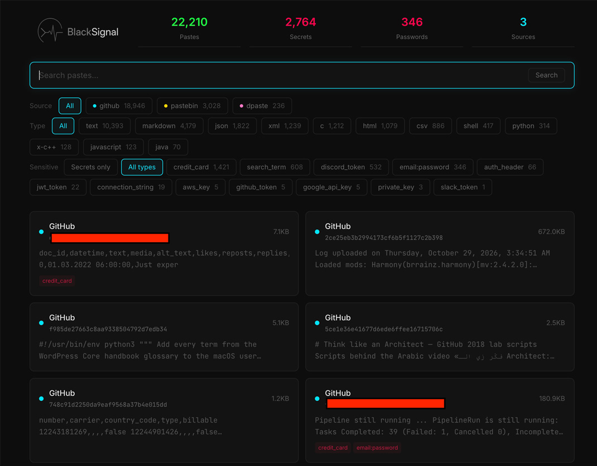

# BlackSignal


A fast, self-hosted web application to **browse, search, categorize and analyze paste data** from multiple paste sites (e.g. Pastebin, GitHub Gists, dpaste, pastes.io). It indexes pastes into a full-text search engine and automatically flags **sensitive information** — leaked credentials, API keys, private keys, connection strings and more.

Best used in combination with my paste scraper project [rndinfosecguy/Scavenger](https://github.com/rndinfosecguy/Scavenger).

> **FOR RESEARCH ONLY.** This tool is intended for researchers and defenders to detect exposed secrets on public paste sites before attackers exploit them. Do not host or distribute breach data.

---

## Features



- **Search & browse** — full-text search (SQLite FTS5) across pastes with pagination
- **Filtering** — by source site, detected content type, and specific sensitive-data categories
- **Sensitive-data detection** — automatic regex/keyword scanning for:
  `email:password`, `private_key`, `aws_key`, `github_token`, `stripe_key`, `google_api_key`, `jwt_token`, `slack_token`, `discord_token`, `connection_string`, `onion_address`, `auth_header`, `credit_card`, `heroku_api_key` + custom search terms
- **Secret-first detail view** — detected secrets are shown at the top of a paste, with the full content collapsed by default
- **Syntax highlighting** — highlight.js for different coding languages
- **HTTP Basic Auth** — htpasswd protection, credentials auto-generated on first boot
- **Periodic re-indexing** — automatic daily scan for new/changed pastes

## Tech Stack

| Layer | Technology |
|---|---|
| Backend | Python, FastAPI, uvicorn |
| Database | SQLite 3 + FTS5 (full-text) |
| Frontend | React, Vite, Tailwind CSS v4, highlight.js |
| Reverse proxy / auth | nginx + htpasswd |
| Runtime | Docker / docker-compose |

## Architecture

```
┌─────────────┐     ┌──────────────────────────────┐     ┌─────────────────────┐
│ raw_pastes/ │────▶│  backend (FastAPI + indexer) │────▶│  SQLite + FTS5      │
│(source dirs)│     │  - daily indexing            │     │  - search / metadata│
└─────────────┘     │  - secret detection          │     └─────────────────────┘
                    │  - REST API                  │
                    └───────────────┬──────────────┘
                                    │ /api
                    ┌───────────────▼───────────────┐
                    │  nginx (port 80)              │
                    │  - htpasswd auth              │
                    │  - serves React SPA           │
                    │  - gzip + proxy to backend    │
                    └───────────────┬───────────────┘
                                    │
                                 Browser
```

## Project Structure

```
BlackSignal/
├── backend/
│   ├── main.py          # FastAPI app + routes + lru_cache response caching
│   ├── database.py      # SQLite/FTS5 schema, queries, indexed access
│   ├── indexer.py       # Walk raw_pastes/, detect content types
│   ├── detector.py      # Sensitive-data regex/keyword patterns
│   ├── scheduler.py     # Periodic re-indexing (APScheduler), threaded pipeline
│   └── searchterms.txt  # Custom search terms (Scavenger-style)
├── frontend/
│   ├── src/
│   │   ├── App.tsx          # Main UI (filter state, indexing overlay)
│   │   ├── hooks/           # usePastes — data fetching, index-status polling
│   │   ├── components/      # PasteCard, PasteDetail, FilterChips, SearchBar, …
│   │   └── styles/          # Tailwind v4 + dark hacker theme
│   └── public/bs_logo.png
├── raw_pastes/          # Paste data (one subdir per source, gitignored contents)
├── data/                # Runtime DB + credentials (gitignored)
├── nginx/default.conf   # Reverse proxy + htpasswd + gzip
├── docker-entrypoint.sh # Generates auth creds, starts nginx + backend
├── Dockerfile           # Multi-stage build (node → python)
├── setup.sh             # One-command Docker + Compose installer
└── docker-compose.yml
```

## Quick Start

### 0. Install required software
```bash
./setup.sh
```

### 1. Prepare your data

Place pastes into `raw_pastes/`, one subfolder per source site (name = source):

Example
```
raw_pastes/
├── pastebin/
├── github/
├── dpaste/
└── pastesio/
```

### 2. Run

```bash
docker compose up -d --build
```

> Default port is `9090`. Edit in `docker-compose.yml`.

On first boot the app indexes every paste file in `raw_pastes/` and prints generated credentials. During indexing the web UI shows a progress bar with file count; once complete it automatically switches to the normal interface.

```
┌──────────────────────────────────────┐
│     BlackSignal Web App Credentials  │
│                                      │
│  URL:     http://localhost:9090      │
│  Username: admin                     │
│  Password: <random>                  │
└──────────────────────────────────────┘
```

The credentials are persisted in the folder `data`. To set a fixed password in the docker compose file, add:

```yaml
environment:
  - AUTH_PASSWORD=your-password
```

### 3. Open

Visit `http://localhost:9090`

## API Documentation

| Method | Endpoint | Description |
|---|---|---|
| GET | `/api/pastes` | Paginated/searchable list. Params: `q`, `source`, `content_type`, `has_secrets`, `secret_type` (repeatable, OR), `page`, `per_page` |
| GET | `/api/pastes/{id}` | Full paste content + detected secrets |
| GET | `/api/stats` | Filter-aware counts (past/secrets/passwords/sources) |
| GET | `/api/sources` | Source distribution |
| GET | `/api/types` | Content-type distribution |
| GET | `/api/secret-types` | Detected secret categories with counts |
| GET | `/api/index-status` | Indexer progress: `{ running, current, total, phase }` |
| POST | `/api/reindex` | Trigger a manual re-index |
| GET | `/api/version` | App version: `{ version: "0.9.0" }` |

Example:

```bash
curl -u admin:PASSWORD \
  "http://localhost:9090/api/pastes?q=apikey&has_secrets=true&secret_type=aws_key&per_page=50"
```

## Disclaimer

This software is provided for educational and research purposes only. Users are solely responsible for compliance with applicable laws and terms of service of any data source. Do not use this tool to store or distribute stolen data.

## License

[MIT](LICENSE) © rndinfosecguy
